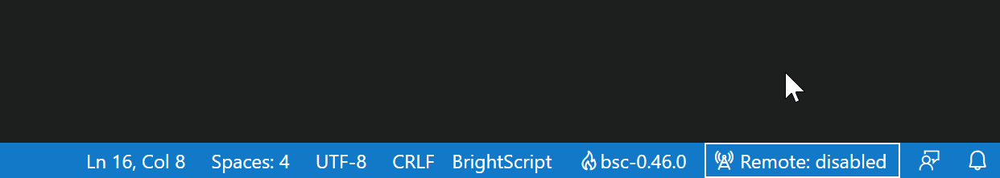
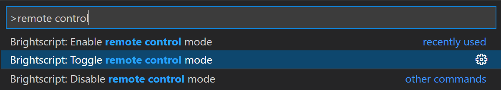

# Remote Control Mode
**Remote Control Mode** is a convenient way to send remote control commands to a Roku entirely from your keyboard in vscode without needing to pick up a physical Roku remote. 

## Turning it on and off
### From the status bar
Click the remote icon in the status bar to toggle remote mode on or off.



### From the command palette


### From the keyboard
Press `ctrl+k` on Windows or `cmd+k` on Mac.

## How it works
When Remote Control Mode is activated, we enable about 100 key bindings that capture most of the standard US keyboard keys. At this point, you may use your keyboard to send text input, use the arrow keys to send left/right/up/down button presses, etc. Most keyboard strokes will be sent to the Roku device as input rather than to your editor. Some notable exceptions include when: the command palette is open, an input box is open, or you are focused on other input areas like a search box. Once you're finished, simply disable **remote control mode**.

**Remote Control Mode** has support for full text input from the keyboard. For example, if you pressed `shift+b` while **Remote Control Mode** is active we will send `B` to the device. We support all the single press and shift press ascii characters on the keyboard (excluding the num pad). For example: `a-z`, `A-Z`, `0-9`, and all the primary symbols such as `!`, `@`, `#`, `'`, `"`, etc...

Here are many of the registered key bindings. You can see the full list in the [package.json](https://github.com/rokucommunity/vscode-brightscript-language/blob/master/package.json) under `keybindings`.

**Note: We do not support sending alt characters directly from the keyboard.** This can be done via the `extension.brightscript.sendRemoteText` command.

| Keybinding (Windows) | Keybinding (Mac) | Roku Button     | Description                                                                                         |
| -------------------- | -------------------- | --------------- | ----------------------------------------------------------------------------------------------- |
| `Up`                 | `Up`                 | Up              |                                                                                                 |
| `Down`               | `Down`               | Down            |                                                                                                 |
| `Left`               | `Left`               | Left            |                                                                                                 |
| `Right`              | `Right`              | Right           |                                                                                                 |
| `Enter`              | `Enter`              | OK              |                                                                                                 |
| `Escape`             | `Escape`             | Back            |                                                                                                 |
| `Delete`             | `Delete`             | Back            |                                                                                                 |
| `Home`               | `Home`               | Home            |                                                                                                 |
| `Shift+Escape`       | `Shift+Escape`       | Home            |                                                                                                 |
| `Ctrl+Escape`        | `Cmd+Escape`         | Home            |                                                                                                 |
| `Backspace`          | `Backspace`          | Instant Replay  | Can also be used to delete the character to the left of the cursor in an input box              |
| `Ctrl+Backspace`     | `Cmd+Backspace`      | Backspace       | Delete the character to the left of the cursor in an input box                                  |
| `Ctrl+Enter`         | `Cmd+Enter`          | Play/Pause      |                                                                                                 |
| `End`                | `End`                | Play/Pause      |                                                                                                 |
| `MediaPlayPause`     | `MediaPlayPause`     | Play/Pause      | VSCode does not block this button's system action, so only use this if you're not playing audio |
| `Ctrl+Left`          | `Cmd+Left`           | Rewind          |                                                                                                 |
| `PageUp`             | `PageUp`             | Rewind          |                                                                                                 |
| `MediaTrackPrevious` | `MediaTrackPrevious` | Rewind          | VSCode does not block this button's system action, so only use this if you're not playing audio |
| `Ctrl+Right`         | `Cmd+Right`          | Fast Forward    |                                                                                                 |
| `PageDown`           | `PageDown`           | Fast Forward    |                                                                                                 |
| `MediaTrackNext`     | `MediaTrackNext`     | Fast Forward    | VSCode does not block this button's system action, so only use this if you're not playing audio |
| `Ctrl+8`             | `Cmd+8`              | Star            |                                                                                                 |
| `Ctrl+Shift+8`       | `Cmd+Shift+8`        | Star            |                                                                                                 |
| `Insert`             | `Insert`             | Star            |                                                                                                 |
| `AudioVolumeMute`    | `AudioVolumeMute`    | Volume Mute     | VSCode does not block this button's system action, so only use this if you're not playing audio |

## Customizing Keybindings
You can create your own keybindings by modifying the [keybindings.json](https://code.visualstudio.com/docs/getstarted/keybindings#_advanced-customization) file in vscode. Here's an example entry. Make sure to use the `when` clause from the following example if you want your keyboard shortcuts to be restricted to **Remote Control Mode**.
```json
{
    "key": "Delete",
    "command": "extension.brightscript.pressBackButton",
    "when": "!searchInputBoxFocus && !findInputFocussed && !inCommandsPicker && !inQuickOpen && brightscript.isRemoteControlMode"
}
```