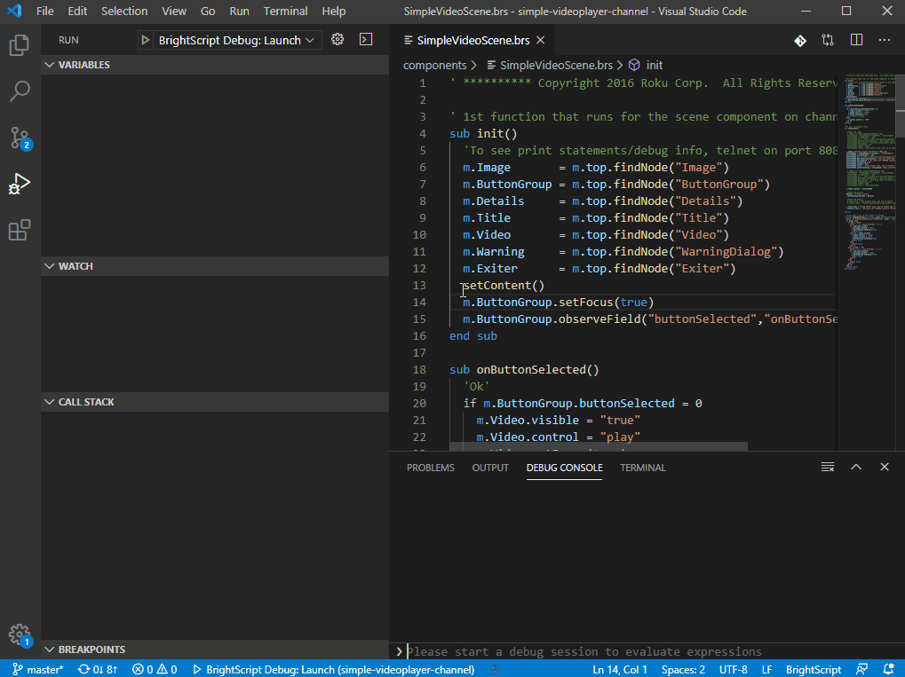

# Features

Everything the extension can do, grouped by what you're working on. New here? Start with the [Quick Start](quick-start.md).

## Writing code
The language features are powered by the [BrighterScript](https://github.com/rokucommunity/brighterscript) language server, and work for both BrightScript (`.brs`) and BrighterScript (`.bs`) files with no configuration for standard Roku projects ([Editing Setup](editing/index.md)).

- **Real-time validation**: syntax errors, undefined functions, wrong argument counts and more, as you type. Problems can be [ignored per line or per file](editing/error-handling.md).
- **Syntax highlighting** for BrightScript, BrighterScript and the code in SceneGraph XML files
- **[Code formatting](editing/code-formatting.md)**, configurable through the `brightscript.format.*` [settings](extension-settings.md#formatting)
- **Navigation**: go to definition (F12), peek definition (Alt+F12), find all references (Shift+F12), document symbols (Ctrl/Cmd+Shift+O) and workspace symbols (Ctrl/Cmd+T)
- **XML support**: go to definition from an XML component to its `extends` component, its script imports and the functions it references
- **Toggle XML/BRS** to jump between a component's `.xml` and its code-behind file, and **Go To Parent Component**
- **Signature help** for function parameters (open parenthesis, or Ctrl/Cmd+Shift+Space)
- **[Snippets](editing/snippets.md)** for common BrightScript and SceneGraph code
- **Preview transpiled code**: see the BrightScript a BrighterScript file compiles to
- **Pick your BrighterScript version** with the [`brightscript.bsdk`](extension-settings.md#brightscriptbsdk) setting, i.e. to match the version your project builds with

## Running and debugging
See [Debugging Setup](debugging/index.md) to get started, and [Launch Configuration](debugging/launch-configuration.md) for every option.

- **One click debugging**: package your app, side-load it onto a Roku device and attach the debugger, from the Run and Debug panel or with F5
- **Breakpoints**, including conditional breakpoints, hit counts and logpoints, plus stepping, the call stack, and variable inspection
- **Debug Console**: your app's output, and a console to run BrightScript while the app is paused
- **[Source maps](debugging/source-maps.md)**, so breakpoints and errors map back to your original source when you build with your own tools
- **[Component libraries](debugging/component-libraries.md)**: package, host and side-load component libraries alongside your app
- **[Deep linking](debugging/deep-linking.md)**: launch your app with a deep link
- **[`bs_const` values](debugging/bs-const.md)** set from your launch configuration
- **[Variable substitutions](variable-substitutions.md)** like `${promptForHost}`, and values from a [`.env` file](debugging/env-file.md)
- **[Advanced project setups](debugging/advanced-project-setup.md)**, like custom build scripts and source files spread across several folders
- **[RALE](debugging/rale.md)**: inject the Roku Advanced Layout Editor tracker task without committing it to your repo
- **SceneGraph debug commands** (port 8080) from the command palette, like `chanperf`, `sgnodes` and `fps_display`, or run them automatically at the start of every session with [`autoRunSgDebugCommands`](debugging/launch-configuration.md#autorunsgdebugcommands)
- **Profiling**: control BrightScript profiling (`bsprof`), and record Perfetto traces and heap snapshots

## Device tools
These panels show up in the Run and Debug sidebar.

- **Devices**: every Roku on your network (found automatically) plus the devices you add in your settings, with their details. Pick which one to deploy to. See [How Devices Are Discovered](contributing/device-discovery.md) for how the list is kept up to date.
- **Roku Device View**: a live view of the device's screen
- **SceneGraph Inspector**: browse the running app's SceneGraph node tree, inspect and edit node fields, and see node counts by type
- **Roku Registry**: view and edit the app's registry
- **Roku File System**: browse the files on the device, across all of its volumes (like `pkg:/` and `tmp:/`)
- **Roku App Overlays**: lay images over the Roku Device View, i.e. to compare your UI against a design mockup
- **RTA Tools**: send any [Roku Test Automation](https://github.com/triwav/roku-test-automation) command to the device, and test how your app behaves under memory pressure
- **Roku Automation**: build and run scripted sequences of steps, like key presses and text entry
- **Roku REPL**: run BrightScript on the device while your app is running
- **Rendezvous**: track rendezvous (thread synchronization) between threads, to find what's slowing your app down. Needs `logrendezvous` turned on, which [`autoRunSgDebugCommands`](debugging/launch-configuration.md#autorunsgdebugcommands) can do for you.
- **Solid Devtools**: a live component tree and inspector for apps built with SolidJS

## Controlling the device
- **[Remote control mode](debugging/remote-control-mode.md)**: use your keyboard as a Roku remote
- Commands to send text to the device, change its volume or input, and restart the app that's installed
- **Roku Cloud Emulator**: manage your cloud emulator devices from the Device Manager panel, and debug on them like any other Roku

## Device logs
The **BrightScript Log** output panel shows the device's output.

- **Clickable `pkg:/` paths**: Alt+click a `pkg:/` path in the log to open that file in your project. Choose how they're shown with the [`brightscript.output.hyperlinkFormat`](extension-settings.md#brightscriptoutputhyperlinkformat) setting:
  - **Full**: `pkg:/components/KeyLogTester.brs(24:0)`
  - **FilenameAndFunction**: `KeyLogTester.DoSomething(24:0)`
  - **Filename**: `KeyLogTester.brs(24)`
  - **Short**: `#1`
  - **Hidden**: no link text at all
- **Filters**: show only the lines you care about with a log level filter (i.e. `^\[(info|warn|debug)\]`), an include filter (i.e. `NameOfSomeInterestingComponent`) and an exclude filter (i.e. `NameOfSomeNoisyComponent`)
- **Mark** the log (Ctrl+L) to make it easy to find where something started
- **Clear** the log (Ctrl+K). Use the extension's command to clear it (rather than VS Code's), or the clickable links and filters can get out of sync.
- The log is searchable, and can be colorized with an extension like [Output Colorizer](https://marketplace.visualstudio.com/items?itemName=IBM.output-colorizer)

See [Keyboard Shortcuts](keyboard-shortcuts.md) for all of the shortcuts.

## Tasks
**[BrightScript tasks](brightscript-tasks.md)** automate your build and deploy workflow, with interactive folder selection (`${folderForFile: <glob>}`), custom shells and environment variables, problem matchers, and background tasks for watchers and dev servers.
