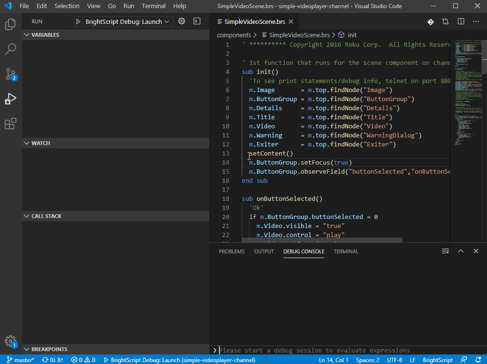

# BrightScript Language for VS Code

The popular VS Code extension for Roku development, used by thousands of Roku developers around the world. Write BrightScript and [BrighterScript](https://github.com/rokucommunity/brighterscript) with real-time validation, side-load and debug your app on a Roku device, and inspect it while it runs, all without leaving the editor.

## Get started
- **[Quick Start](quick-start.md)**: from install to your first debug session in a few minutes
- [Installation](installation.md), and how to try [pre-release builds](prerelease-versions.md)
- [Debugging Setup](debugging/index.md): the `launch.json` basics

## What's inside
- **[Writing code](features.md#writing-code)**: validation, formatting, go to definition, find references and more, powered by the BrighterScript language server
- **[Running and debugging](features.md#running-and-debugging)**: one click side-loading, breakpoints, variable inspection, a debug console, source maps and component libraries
- **[Device tools](features.md#device-tools)**: a live view of the device's screen, the SceneGraph Inspector, the registry, the file system and more
- **[Device logs](features.md#device-logs)**: filtering, marking, and clickable links from `pkg:/` paths to your source
- **[Remote control mode](debugging/remote-control-mode.md)**: control your Roku from your keyboard

## Reference
- [Extension Settings](extension-settings.md): every setting the extension contributes
- [Launch Configuration](debugging/launch-configuration.md): every `launch.json` option
- [Keyboard Shortcuts](keyboard-shortcuts.md)

## Community
This extension is built by [RokuCommunity](https://rokucommunity.github.io), and it's open source. Questions? Find us in the `#vscode-bs-lang-ext` channel of the [Roku Developers Slack](https://join.slack.com/t/rokudevelopers/shared_invite/zt-4vw7rg6v-NH46oY7hTktpRIBM_zGvwA). Found a bug or have an idea? [Open an issue](https://github.com/rokucommunity/vscode-brightscript-language/issues). Want to help? See [Contributing](contributing/index.md).
