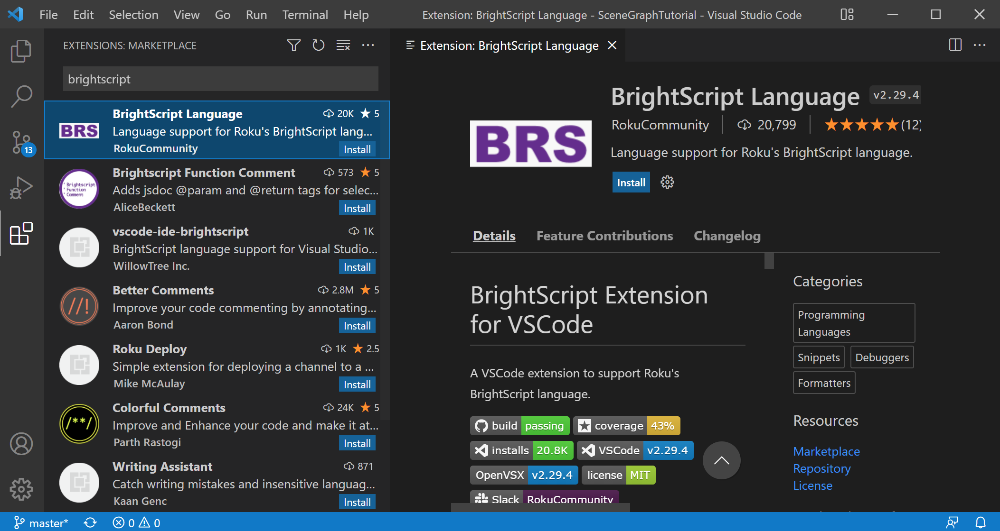
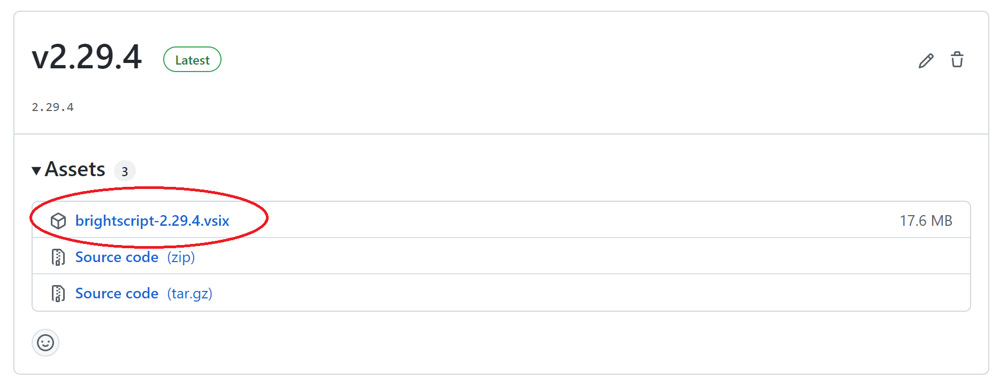
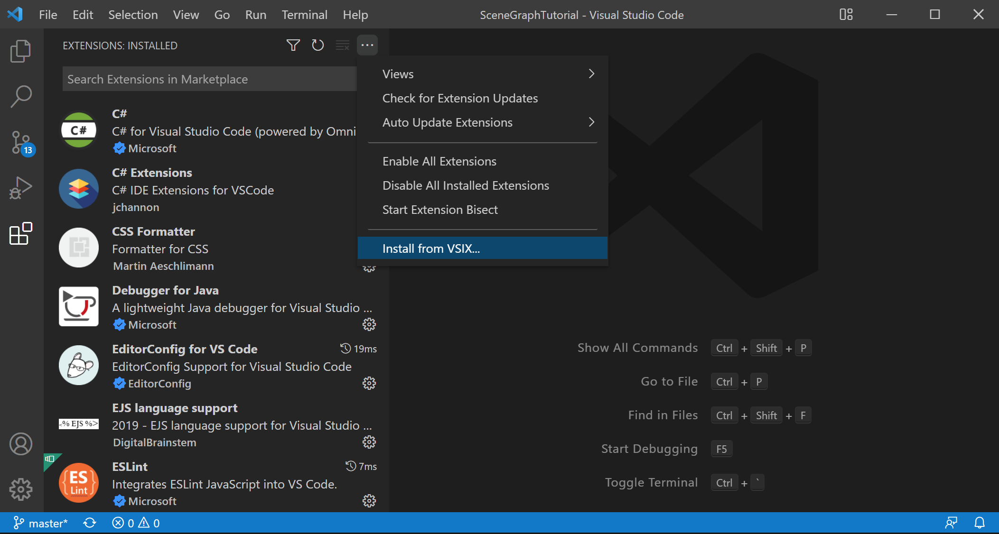

# Installation
## From VSCode
1. Search for "BrightScript" in the vscode extensions tab
2. Click "Install"

    

## From GitHub
1. Navigate to our GitHub releases page: https://github.com/rokucommunity/vscode-brightscript-language/releases
2. Download the latest release version `vsix`. For example:

    
3. In the VSCode extensions tab, open the `...` menu, click `Install from VSIX...` and select the vsix downloaded from step 2
    