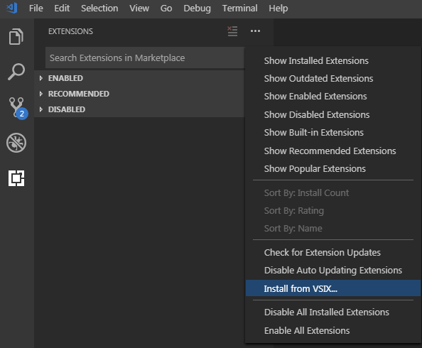

# Pre-release Versions

You can occasionally find pre-release versions of this extension under the [GitHub Releases](https://github.com/RokuCommunity/vscode-brightscript-language/releases) page of this project. These builds aren't published to the VS Code Marketplace, so you install them by hand from their `.vsix` file. Here's how it works.

1. Download the `.vsix` file for the version of the extension you want from [the releases page](https://github.com/RokuCommunity/vscode-brightscript-language/releases).
2. Open Visual Studio Code and click the "extensions" tab.
3. Choose "Install from VSIX..."

    

4. Select the file you downloaded from step 1.

## Reinstalling store version of the extension

This process will REPLACE any existing version of the extension you have installed from the store. So, if you want to go back to using the store version, you need to uninstall the extension completely, and then install the extension through the VSCode store.
